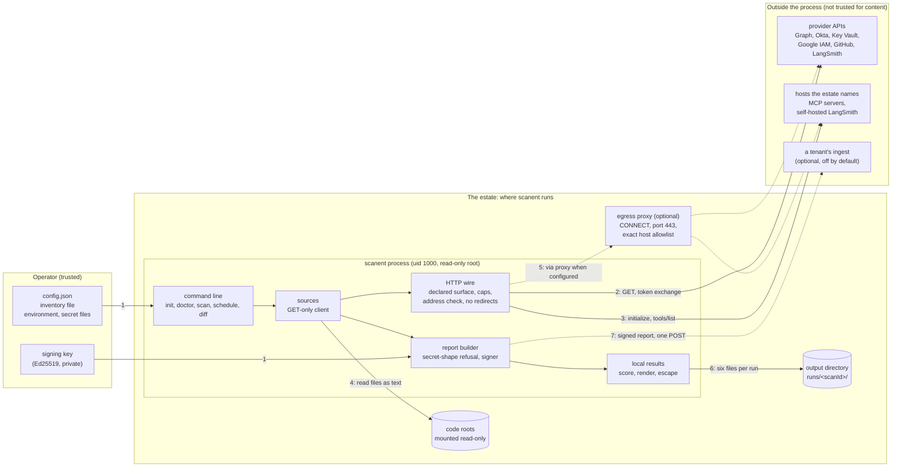

# Architecture

Components, data flows and trust boundaries, for a security reviewer. The
threats at each boundary, their mitigations and the residual risks are in the
[threat model](../threat-model.md) and are not repeated here.

## What it is

One process, started by hand or by a schedule, inside the estate it scans.
The scanner listens on no port and accepts no inbound connection. (The
optional egress proxy, a second container started from the same image,
listens on one port, 3128, for the scanner; in the Compose overlay that
port is on an internal network the two containers share.) It reads the configured
sources with read-only credentials, builds one report, signs it, and writes
the results to a directory. It keeps no state between runs other than the
files it wrote.

It is three packages in one repository, and one container image:

| Component | Path | What it does |
|---|---|---|
| Contract | `packages/contract` | The report's strict schemas, the six-level harness ladder (H0 to H5), the findings planner, canonical JSON, signature verification. No input or output of its own |
| Scanner | `packages/scanner` | The command line, the configuration, the sources, the HTTP wire, the report builder and signer, the outputs, the egress proxy |
| Report | `packages/report` | Local results: scores a signed report against the ladder, renders `results.json`, the CSV files and `summary.html`, compares two runs. Pure functions: lint refuses Node built-ins, the clock, the process and the network there |
| Image | `deploy/Dockerfile` | Compiled JavaScript on a distroless Node base, uid 1000, no shell and no package manager |
| Deployment templates | `deploy/compose.yaml`, `deploy/compose.egress.yaml`, `deploy/helm/scanent` | Compose, an egress overlay, a Helm chart |

Run-time dependencies from outside the repository: `zod`, `typescript` (its
parser only, to read JavaScript and TypeScript as text), `js-yaml` and its
dependency `argparse`. See [SBOM and licences](sbom-and-licences.md).

## Diagram

The numbers on the arrows are the trust boundaries below. Dotted arrows are
optional paths. Boundary 8, release pipeline to client, is how the image
arrives and is not a run-time flow.

## Data flows

| # | Flow | What crosses | Direction |
|---|---|---|---|
| 1 | Operator to scanner | The configuration (identifiers and the names of credential variables, never values), an optional inventory, credentials through the environment or files, the signing key | In |
| 2 | Scanner to a provider API | A GET with a read credential; for Microsoft and Google first a token exchange (the one POST a source causes). JSON comes back | Out, then in |
| 3 | Scanner to a host the estate names | The MCP listing: `initialize`, the initialized notification, `tools/list`. Or the LangSmith reads against a self-hosted address | Out, then in |
| 4 | Scanner to a code root | Directory listings and file contents, read as text | In |
| 5 | Scanner to the egress proxy | CONNECT requests; the proxy opens the tunnel or refuses | Out |
| 6 | Scanner to the output directory | Six files per run and a pointer to the newest run | Out |
| 7 | Scanner to a tenant | The signed report, in one POST. Only when configured. Separately, and only when the register source is configured: a token exchange and one call of one named read tool, to read the tenant's agent register | Out; the register read also in |
| 8 | Release pipeline to client | The image, the chart, the air-gapped bundle | In, before run time |

Every request of flows 2, 3 and 7 is declared in
`packages/scanner/src/scanner-surface.ts` and listed for a reader in
[Network and permissions](../network-and-permissions.md).

**What the report carries:** agent and principal identifiers, credentials by
reference with their dates, tool names and definition hashes, model
endpoints, declared skills by name, owner identifiers, the verdicts each source holds
evidence for, and each source's status. **What it never carries:** a
credential value, a level, a completeness flag. The level is derived by the
reader of the report; [the report contract](../contract.md) defines both.

## Trust boundaries

The same eight boundaries as the threat model, in one line each. The link
goes to the table of threats and mitigations for that boundary.

| # | Boundary | Trusted | Not trusted |
|---|---|---|---|
| 1 | [Operator to scanner](../threat-model.md#1-operator-to-scanner) | The operator | A typo: every file is parsed strictly, and a secret-shaped string in the configuration refuses it |
| 2 | [Scanner to a provider API](../threat-model.md#2-scanner-to-a-provider-api) | The provider's identity, by TLS | The content of its answers |
| 3 | [Scanner to a host the estate names](../threat-model.md#3-scanner-to-a-host-the-estate-names) | Nothing | The name, and what it resolves to |
| 4 | [Scanner to a code root](../threat-model.md#4-scanner-to-a-code-root) | Nothing | Everything in the tree |
| 5 | [The egress proxy](../threat-model.md#5-the-egress-proxy) | The proxy's own code | Its clients |
| 6 | [The output directory](../threat-model.md#6-the-output-directory) | The directory's owner | Other local users |
| 7 | [Scanner to a tenant](../threat-model.md#7-scanner-to-a-tenant) | The tenant's answer, as a status only | Anything else in the answer |
| 8 | [Release pipeline to client](../threat-model.md#8-release-pipeline-to-client) | Established by signature | Assumed nothing. No release exists yet: see [Assurance status](assurance-status.md) |

## Where the secrets are

| Secret | Where it lives | Who can read it |
|---|---|---|
| Read credentials | Environment variables, or files named by `<NAME>_FILE`. Never in the configuration | The scanner's user, and anyone who can read that user's environment, files or memory |
| Signing key (private) | A file written `0600` by `init` or `keygen`, or an environment variable | The same |
| Signing key (public) | In every signed report | Anyone with a report |
| A tenant's ingest key | As a read credential. Needed only when posting is configured | The same |

Nothing in the design defends against root on the host or a cluster
administrator (threat model, residual risk 7).

## What is deliberately absent

- No inbound listener in the scanner, no web interface, no database. The
  optional egress proxy is the one part of the image that listens, and it
  accepts CONNECT only.
- No update check, no telemetry, no call to the authors.
- No plug-in loading: a source is compiled in, and lint refuses dynamic
  import and `require` in the scanner.
- No execution of scanned code: the code source tokenises Python and parses
  JavaScript and TypeScript, and lint refuses subprocess, VM and module-loader
  imports under it.
- No shell and no package manager in the image.
